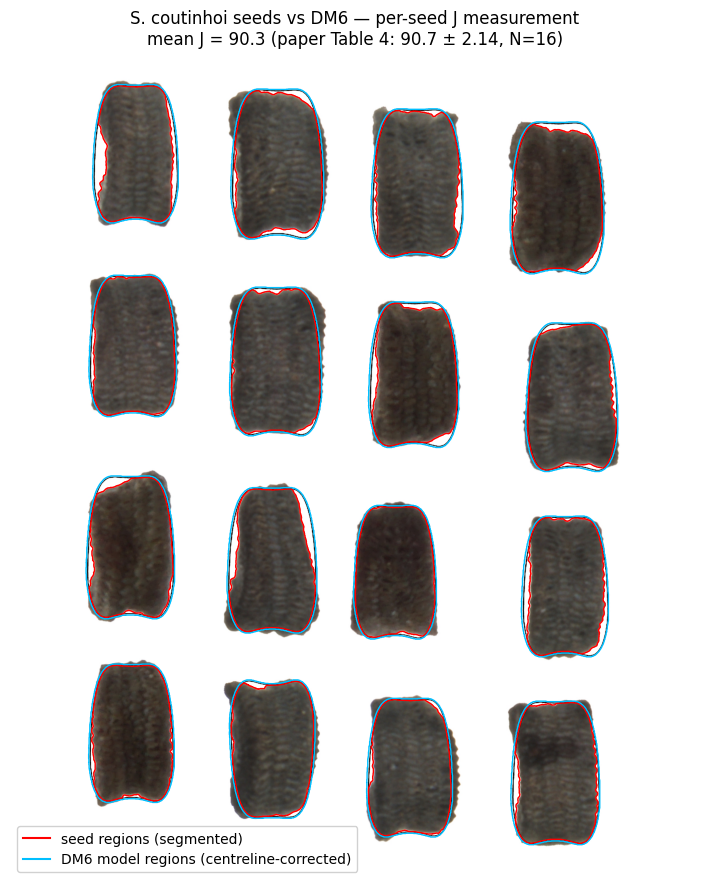
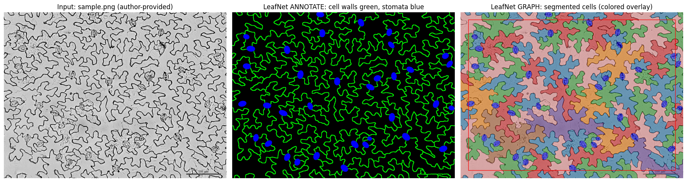
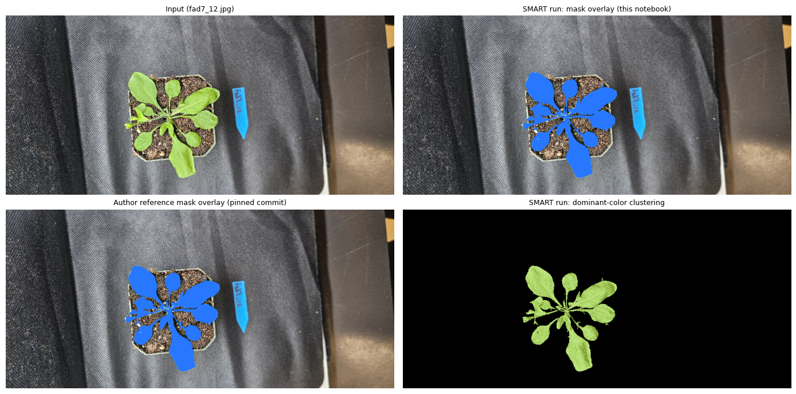
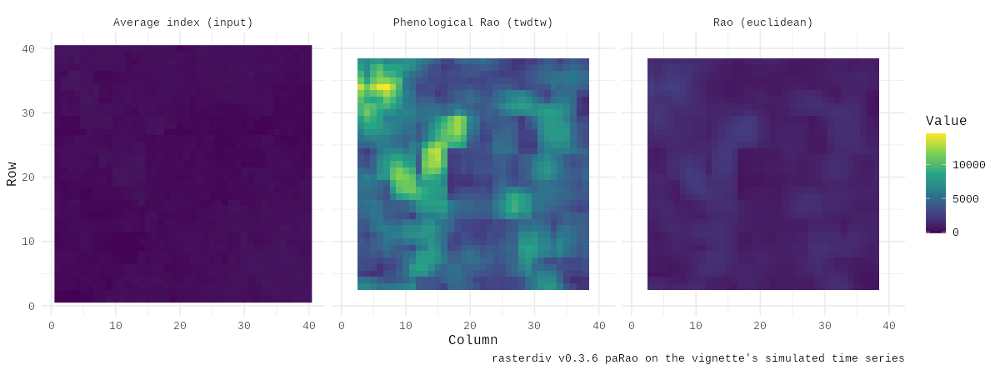

# Notebook catalog — page 6 of 9

[README / notebook index](../README.md#notebooks) · [Previous](page-005.md) · [Next](page-007.md)

Alphabetical entries 251–300 of 423. Generated from publication.json; includes generation conditions and execution previews.

| Paper and run details | Preview |
| --- | --- |
| **MinneApple: A Benchmark Dataset for Apple Detection and Segmentation** <b>Journal:</b> arXiv <b>Authors:</b> Nicolai Häni · Pravakar Roy · Volkan Isler public_id: <code>p-feca74983cc9d1c5ff2a8dc4937dc604</code>        <b>Generated with:</b> OpenCode · spark-local/GLM-5.3-Flash-EXL3 · variant: high <b>Demonstration:</b> Reproduces MinneApple&#x27;s released detection annotations for one training image end to end: per-instance mask decoding and on-the-fly bounding-box extraction with the author&#x27;s verbatim AppleDataset loader (no detector run; no public weights exist).  <b>Semantic tags:</b> crop:apple, environment:field, organ:fruit, task:counting, task:object_detection, task:segmentation |  Input orchard image (left) with reference instance masks (center) and reference bounding boxes from the author&#x27;s AppleDataset (right); reference annotations from detection.tar.gz, not model predictions. |
| **Model selection and parameter estimation for root architecture models using likelihood-free inference.** <b>Journal:</b> Journal of the Royal Society, Interface <b>Authors:</b> Ziegler C, Dyson RJ, Johnston IG. public_id: <code>p-9d34a23737718edc5e1277da0358385a</code>        <b>Generated with:</b> OpenCode · spark-local/GLM-5.3-Flash-EXL3 · variant: low <b>Demonstration:</b> Runs the authors&#x27; pinned MATLAB ABC-SMC root-architecture inference (StochasticBiology/root-inference @ da98de2) under GNU Octave on the embedded Arabidopsis summary statistics (N=100, final tolerance 3), reproducing parameter posteriors and model selection; a single minimal example, not a full-paper verification.  <b>Semantic tags:</b> organ:root, task:morphology, trait:growth_development, trait:root_architecture |  ABC-SMC parameter posteriors for growth rate g, branching rate b, lateral ratio gl and l_max on the embedded Arabidopsis data (final tolerance 3) |
| **MPRT-DETR: Multi-Platform Real-Time Rice Panicle Detection and Counting Based on the Transformer Method and Complex Field Imagery** <b>Journal:</b> SSRN Electronic Journal <b>Authors:</b> Jianmin Wu · Lei Zhang · Xiaolei Qiu · Jun Lu · D Wang · Yangyang Gu · Yan Zhu · Xia Yao public_id: <code>p-7c422f1d6dcf374a3fd4446e139e0fa4</code>        <b>Generated with:</b> OpenCode 1.18.34 · spark-local/GLM-5.3-Flash-EXL3 · variant: high · reasoning effort: high <b>Demonstration:</b> Loads the authors&#x27; released MPRT-DETR best.pt with their pinned code and runs single-image rice panicle detection/counting on their demo image with predict.py settings (100 predicted vs 87 reference panicles); not a dataset-level benchmark reproduction.  <b>Semantic tags:</b> crop:rice, environment:field, organ:inflorescence, organ:whole_plant, task:counting, task:object_detection |  Demo test image: authors&#x27; reference labels (87 panicles, green) vs released best.pt predictions (100 panicles, red) |
| **Multi-scale spatial-temporal remote sensing fusion for phenology identification in rice germplasm resources.** <b>Journal:</b> Plant Phenomics <b>Authors:</b> Huimin Wang · Wei Guo · Yue Mu · Yang Zhang · Haozhou Wang · Yandong Yang · Hu Xu · Yanfeng Ding · Shirong Zhou · Ganghua Li · Seishi Ninomiya public_id: <code>p-a349992a9a7f836d25123f526c58c28a</code>        <b>Generated with:</b> OpenCode · spark-local/GLM-5.3-Flash-EXL3 · variant: low <b>Demonstration:</b> Inference-only run of the authors&#x27; released predict.py (MAGF+LSTM, pinned commit 5b9c2dd) on the repository&#x27;s datatest examples (10 plots) with the delta3 checkpoint; OA 0.946 on the example set only, not a paper-benchmark reproduction.  <b>Semantic tags:</b> crop:rice, environment:aerial, organ:whole_plant, task:classification, task:time_series, trait:growth_development |  Pinned example inputs: 20 m MR (left) and 4 m HR (right) images of plot J1B265 on 2024-08-22, ground-truth class Jointing stage (from datatest/). |
| **Multi-view BLUP: a promising solution for post-omics data integrative prediction** <b>Journal:</b> Journal of Genetics and Genomics <b>Authors:</b> Wu B, Xiong H, Zhuo L, Xiao Y, Yan J, Yang W. public_id: <code>p-2bd31da0e632a80444251edc20a538de</code>       <b>Generated with:</b> OpenCode · spark-local/GLM-5.3-Flash-EXL3 · variant: low <b>Demonstration:</b> Runs the authors&#x27; pinned MVBLUP R demo (8 views, 100 individuals, trait 1): differential-evolution view-weight learning with rrBLUP 5-fold CV fitness, achieving test accuracy 0.9459 identical to the author reference; the small bundled demo data do not validate the paper&#x27;s published dataset-level results. |  MVBLUP differential-evolution learning curve: per-view optimal weights across iterations, reproduced from the authors&#x27; pinned demo (author reference match). |
| **MultiSpecies Canopy Segmentation: Interactive Machine-Learning and Pseudo-Labelling are key** <b>Journal:</b> openRxiv <b>Authors:</b> Charles Rongione · Abraham George Smith · Céline Chevalier · Christophe De Vleeschouwer · Guillaume Lobet · Xavier Draye public_id: <code>p-2dd6fd1be92fcec749243867b246d5e1</code>        <b>Generated with:</b> OpenCode 1.18.34 · spark-local/GLM-5.3-Flash-EXL3 · variant: high · reasoning effort: high <b>Demonstration:</b> Headless reproduction of LeafPainter interactive GBDT binary pseudo-labeling (paper sec. 2.3.1) on the author&#x27;s bundled example image using the recorded annotation and exact Trainer.py parameters; CPU only, single image.  <b>Semantic tags:</b> organ:whole_plant, task:classification, task:segmentation |  Input &#x27;feuille sal.jpg&#x27; (left) and the generated binary plant/background pseudo-label (right, LightGBM GBDT at resolution 0.2, Spectral colormap) |
| **Natural variation in stomata size contributes to the local adaptation of water-use efficiency in Arabidopsis thaliana.** <b>Journal:</b> Molecular ecology <b>Authors:</b> Dittberner H, Korte A, Mettler-Altmann T, Weber APM, Monroe G, de Meaux J. public_id: <code>p-a19e4f562c64e84e85556bde60dcad78</code>        <b>Generated with:</b> OpenCode · spark-local/GLM-5.3-Flash-EXL3 · variant: low <b>Demonstration:</b> Executed the authors&#x27; Appendix S2 R code on the published Dryad tables to reproduce stomata-size/density heritabilities (0.372/0.294), trait correlations and climatic-PC GLMs; genotype-dependent sections (GWAS, QST-FST, genetic-PC covariates) are not reproducible from published data.  <b>Semantic tags:</b> crop:arabidopsis, modality:microscopy, organ:stomata, task:morphology, trait:stomatal_traits, trait:water_status |  Stomata size vs density accession means (r = -0.51) and broad-sense heritabilities from the authors&#x27; lme models and the Python cross-check, compared with the paper&#x27;s values. |
| **NeuraLeaf: Disentangled Neural Parametric Modeling of Leaf Shape, Deformation, and Appearance** <b>Journal:</b> International Journal of Computer Vision <b>Authors:</b> Yang Yang · Risa Shinoda · Hiroaki Santo · Yasuyuki Matsushita · Fumio Okura public_id: <code>p-744d06547d0cf81dc008f601a6fe839c</code>        <b>Generated with:</b> Generation conditions not recorded <b>Demonstration:</b> Shape generation plus leaf deformation transfer and interpolation. The fitting example is a model-generated round-trip; appearance modeling and dataset-level benchmarks are outside this run.  <b>Semantic tags:</b> modality:rgbd, organ:leaf, task:morphology, task:reconstruction, trait:leaf_traits |  Leaf shape and deformation results across four examples |
| **New Geometric Models for Shape Quantification of the Dorsal View in Seeds of Silene Species** <b>Journal:</b> Plants <b>Authors:</b> José Luis Rodríguez-Lorenzo · José Javier Martín-Gómez · Ángel Tocino · Ana Juan · Bohuslav Janoušek · Emilio Cervantes public_id: <code>p-fbb38ad1b0359d1d5c678140ab439154</code>        <b>Generated with:</b> OpenCode 1.18.34 · spark-local/GLM-5.3-Flash-EXL3 · variant: high · reasoning effort: high <b>Demonstration:</b> Recomputes the paper&#x27;s J-index for Silene coutinhoi vs dorsal model DM6 per seed (16 seeds) from the authors&#x27; deposited compositions in Python: mean J 90.28 (sd 2.17) vs published 90.7 (2.14); an AI-assisted Python adaptation of the manual ImageJ protocol, not a full-paper reproduction.  <b>Semantic tags:</b> organ:seed, task:classification, task:morphology, trait:reproductive_traits |  Original deposited S. coutinhoi composition with measured seed regions (red) and centreline-corrected DM6 model regions (blue) overlaid; per-seed J mean 90.28 vs published 90.7 (Table 4). |
| **No more manual counting: LeafNet quantifies the leaf surface** <b>Journal:</b> The Plant Cell <b>Authors:</b> Ching Chan public_id: <code>p-b4942a5007c50d6d2afed8d22475f392</code>        <b>Generated with:</b> OpenCode 1.18.34 · spark-local/GLM-5.3-Flash-EXL3 · variant: high · reasoning effort: high <b>Demonstration:</b> Minimal LeafNet reproduction: the authors&#x27; leafnet-cli (pinned commit 6ef237d, recreated Python 3.6/TF 1.13.1 env) segments the bundled bright-field Arabidopsis epidermis sample.png into stomata and pavement cells with statistics; single-image demo, no benchmark claims.  <b>Semantic tags:</b> crop:arabidopsis, environment:laboratory, modality:fluorescence, modality:microscopy, organ:cell, organ:stomata, task:morphology, task:object_detection, task:segmentation, trait:stomatal_traits |  Input sample.png (left) with LeafNet output: annotation of cell walls (green) and stomata (blue), and per-cell colored segmentation overlay. |
| **Non-destructive monitoring of netted muskmelon quality based on its external phenotype using Random Forest** <b>Journal:</b> PloS one <b>Authors:</b> Qian L, Daren L, Qingliang N, Danfeng H, Liying C. public_id: <code>p-f600321f0edf4546dceb0d2a346d3e43</code>        <b>Generated with:</b> OpenCode 1.18.34 · spark-local/GLM-5.3-Flash-EXL3 · variant: high · reasoning effort: high <b>Demonstration:</b> Fits the authors&#x27; random-forest TSS model (75/25 split, repeated 10-fold CV x3, mtry 1-4) on their replication data in R and validates the varImp top-10 simplified model on a 25% holdout; the image-parameter-extraction stage is not reproduced.  <b>Semantic tags:</b> crop:melon, environment:greenhouse, organ:fruit, organ:root, task:physiology, trait:pigment_color, trait:reproductive_traits |  Predicted vs measured TSS on the 25% holdout: full model vs the authors&#x27; simplified top-10-parameter model |
| **Non-invasive hydrodynamic imaging in plant roots at cellular resolution** <b>Journal:</b> Nature Communications <b>Authors:</b> Flavius C. Pascut · Valentin Couvreur · Daniela Dietrich · Nicky Leftley · Guilhem Reyt · Yann Boursiac · Monica Calvo-Polanco · Ilda Casimiro · Christophe Maurel · David E. Salt · Xavier Draye · Darren M. Wells · Malcolm J. Bennett · Kevin F. Webb public_id: <code>p-004ce732f6d0d7eb85c1fa4c08db5865</code>        <b>Generated with:</b> OpenCode · spark-local/GLM-5.3-Flash-EXL3 · variant: low <b>Demonstration:</b> Bounded Colab CPU re-run of the paper&#x27;s inverse-modeling loop 2: the authors&#x27; MECHA 4D-solute D2O wash-out simulator driven against 30 measured Col-0 traces with a 7-point xylem-flow-rate grid scan (best Q_xyl 0.008 cm3/d); the full fmincon/MultiStart 4-parameter optimization and other genotypes are out of scope.  <b>Semantic tags:</b> crop:arabidopsis, modality:spectroscopy, organ:cell, organ:root, task:physiology, trait:water_status |  Objective OF versus xylem flow rate over the scanned grid (left) and the best-fit simulated xylem D2O wash-out trace against the measured Col-0 mean ± SD of 30 plants (right) |
| **Non-invasive phenotyping for water and nitrogen uptake by deep roots explored using machine learning** <b>Journal:</b> Plant and Soil <b>Authors:</b> Satyasaran Changdar · Olga Popovic · Tomke Susanne Wacker · Bo Markussen · Erik Bjørnager Dam · Kristian Thorup-Kristensen public_id: <code>p-53c30ffda67420ce4c09594eec1ecbce</code>        <b>Generated with:</b> OpenCode · spark-local/GLM-5.3-Flash-EXL3 · variant: low <b>Demonstration:</b> Minimal CPU reproduction of the CropML 2018 analysis: 30 Sqrt_pRLD interval features from raw root profiles, author nested-CV RF/GB prediction of log d15N and d13C (out-of-fold r 0.45/0.42 vs paper 0.46/0.41), with SI/D50 depth estimates; the author&#x27;s stored SI values are not exactly reproduced (documented).  <b>Semantic tags:</b> crop:wheat, organ:root, task:morphology, task:physiology, trait:water_status |  RF feature importance by 10-cm soil-depth interval (2018): deep layers around 150-170 cm rank highest for log d15N, reproducing the paper&#x27;s key finding. |
| **Non-invasive Probing of Winter Dormancy via Time-frequency Analysis of Induced Chlorophyll Fluorescence in Deciduous Plants as Exemplified by Apple (Malus × domestica Borkh.)** <b>Journal:</b> Journal not supplied <b>Authors:</b> Shurygin B, Konyukhov I, Khruschev S, Solovchenko A. public_id: <code>p-4931678aea585c01945b0a5ae220bd58</code>        <b>Generated with:</b> OpenCode 1.18.34 · spark-local/GLM-5.3-Flash-EXL3 · variant: high · reasoning effort: high <b>Demonstration:</b> Executed the authors&#x27; FIR low-pass and Morlet wavelet time-frequency analysis of Fv/Fm and DI0/RC on their bundled winter 2020/2021 apple sample in Colab (CPU); one season only, so the paper&#x27;s full-record statistics and figures are not reproduced.  <b>Semantic tags:</b> crop:apple, environment:field, modality:fluorescence, organ:leaf, organ:whole_plant, task:object_detection, task:physiology, task:time_series, trait:growth_development, trait:photosynthesis |  Morlet wavelet spectrogram of DI0/RC (thermal dissipation per reaction center) for the winter 2020/2021 sample with the authors&#x27; ground-truth dormancy-phase annotations (EnD/EcD, destructive-test stars, model dormancy-release line). |
| **Noninvasive Diagnosis of Seedless Fruit Using Deep Learning in Persimmon** <b>Journal:</b> The Horticulture Journal <b>Authors:</b> Kanae Masuda · Maria Suzuki · Kohei Baba · Kouki Takeshita · Tetsuya Suzuki · Mayu Sugiura · Takeshi Niikawa · Seiichi Uchida · Takashi Akagi public_id: <code>p-a607ba3fc5816205c2c44e7b7818d992</code>        <b>Generated with:</b> OpenCode 1.18.34 · spark-local/GLM-5.3-Flash-EXL3 · variant: high · reasoning effort: high <b>Demonstration:</b> Reproduces the paper&#x27;s Grad-CAM (block5_conv3/block3_conv3) and Guided Grad-CAM (block5_conv3) visual-explanation pipeline with a TF2 port of the cited uchidalab/softmaxgradient-lrp implementation on the authors&#x27; example image with ImageNet VGG16; the unpublished persimmon dataset and trained weights remain out of scope.  <b>Semantic tags:</b> modality:rgb, organ:fruit, task:classification, trait:reproductive_traits |  Input example image with Grad-CAM (block5_conv3, block3_conv3) and Guided Grad-CAM (block5_conv3) relevance heatmaps computed in this run. |
| **Nonlinear distributed sensing of light patterns leads to perceptual distortions in plants.** <b>Journal:</b> Proceedings of the National Academy of Sciences of the United States of America <b>Authors:</b> Kempinski A, Porat A, Rivière M, Meroz Y. public_id: <code>p-49a53057ac08e2bd706ee517c1575108</code>        <b>Generated with:</b> OpenCode 1.18.34 · spark-local/GLM-5.3-Flash-EXL3 · variant: high · reasoning effort: high <b>Demonstration:</b> Refits the paper&#x27;s Fig. 2C phototropic transduction function (ODR power law, sin(theta_f) vs I*cos(theta_f)) from the authors&#x27; Zenodo-deposited unilateral dose-response trajectories, recovering nu0/beta=0.71 and alpha=0.30 on CPU; single-figure scope only (no video re-tracking or simulations).  <b>Semantic tags:</b> crop:sunflower, organ:stem, task:physiology, trait:growth_development |  Fig. 2C reproduction: ODR power-law fit of sin(theta_f) versus I*cos(theta_f) with propagated error bars, recovering alpha=0.30 and nu0/beta=0.71 from the deposited data. |
| **Novel method for the quantification of rosette area from images of Arabidopsis seedlings grown on agar plates.** <b>Journal:</b> Applications in plant sciences <b>Authors:</b> Knapp A, Stefani J, Katz E, Bloom AJ. public_id: <code>p-947828c971e3a9b186c0001caf61e052</code>        <b>Generated with:</b> OpenCode · spark-local/GLM-5.3-Flash-EXL3 · variant: low <b>Demonstration:</b> Executed the authors&#x27; pinned plate-as-scale demo (plantcv 3.14.1) on their own test image p6.jpg in a fresh Colab CPU runtime; per-rosette raw pixel areas exactly match the demo&#x27;s saved outputs. One image only - dataset-level validation and ANOVA/heritability analyses are not reproducible (data not public).  <b>Semantic tags:</b> crop:arabidopsis, environment:laboratory, organ:leaf, task:morphology, task:segmentation, trait:leaf_traits |  Author demo image p6.jpg: agar plate with six Arabidopsis seedlings before analysis |
| **NucVerse3D: Generalizable 3D nuclear instance segmentation across heterogeneous microscopy modalities** <b>Journal:</b> bioRxiv (Cold Spring Harbor Laboratory) <b>Authors:</b> Jorge Vergara · Cristian Pérez-Gallardo · Ricardo Velasco · Dilan Martínez · Diego Badilla · Esteban G. Contreras · Pamela Guevara · Fabián Segovia‐Miranda · Hernán Morales‐Navarrete public_id: <code>p-9b8c52df6dcf519bd23a6ae2d96a60c5</code>        <b>Generated with:</b> OpenCode 1.18.34 · spark-local/GLM-5.3-Flash-EXL3 · variant: high · reasoning effort: high <b>Demonstration:</b> Pretrained NucVerse3D (resunet_drosophila-denoised) inference with the authors&#x27; unmodified pipeline on one Drosophila test volume (C2_M01, 154 GT nuclei), compared to the released ground-truth mask (F1 0.643 at IoU 0.5 via an AI-written greedy matcher); single-sample run, not a dataset-level benchmark.  <b>Semantic tags:</b> environment:field, modality:microscopy, modality:xray_ct, organ:cell, organ:whole_plant, task:preprocessing, task:reconstruction, task:segmentation, trait:architecture |  Drosophila C2_M01 input (XY max-intensity projection) with released ground-truth nuclear annotation overlay |
| **Object detection and size determination of pineapple fruit input to a juicing factory in Eastern Cape, South Africa: A deep learning approach** <b>Journal:</b> Springer Science and Business Media LLC <b>Authors:</b> Harris J, Er Ş. public_id: <code>p-676bd2b6c0020eb8a2ba4b41e580ca41</code>        <b>Generated with:</b> OpenCode 1.18.34 · spark-local/GLM-5.3-Flash-EXL3 · variant: high · reasoning effort: high <b>Demonstration:</b> Reproduces the paper&#x27;s size-determination evaluation: the released Model 4 Mask R-CNN detected exactly 120 fruits in the 27 public unseen images and the z-scored KS comparison against the 120 calliper measurements matches the paper (length KS 0.058/p=0.987); CPU-only legacy TF 1.13 stack, training and AP evaluation out of scope.  <b>Semantic tags:</b> crop:pineapple, organ:fruit, task:morphology, task:object_detection, trait:reproductive_traits |  Evaluation image: raw input (left), authors&#x27; VIA ground-truth polygons (center), and the Model 4 predicted mask contour (right). |
| **On the use of leaf water to determine plant water source: A proof of concept** <b>Journal:</b> Hydrological Processes <b>Authors:</b> Paolo Benettin · Magali F. Nehemy · Lucas A. Cernusak · Ansgar Kahmen · Jeffrey J. McDonnell public_id: <code>p-6b94ff9aaefa10c2e9176919d75d6f0d</code>        <b>Generated with:</b> OpenCode 1.18.34 · spark-local/GLM-5.3-Flash-EXL3 · variant: high · reasoning effort: high <b>Demonstration:</b> Exact Python port of the author&#x27;s MATLAB pipeline: Craig-Gordon Monte Carlo evaporation lines and LMWL back-projection of all 84 SPIKE II xylem and leaf samples with leaf-vs-xylem residual validation; paper full text remains unverified and Monte Carlo RNG differs from MATLAB.  <b>Semantic tags:</b> environment:growth_chamber, organ:leaf, task:physiology, trait:water_status |  Theory example: measured leaf and xylem samples (04-Jun-2018 13:35) with individual evaporation lines, projected LMWL sources, and the reference LMWL (dashed). |
| **OPEN leaf : an open‐source cloud‐based phenotyping system for tracking dynamic changes at leaf‐specific resolution in Arabidopsis** <b>Journal:</b> The Plant Journal <b>Authors:</b> Landon G. Swartz · Suxing Liu · Drew Dahlquist · Skyler T. Kramer · Emily S. Walter · Samuel A. McInturf · Alexander Bucksch · David G. Mendoza‐Cózatl public_id: <code>p-64118216d3c05b591360cb6e01b26085</code>        <b>Generated with:</b> OpenCode 1.18.34 · spark-local/GLM-5.3-Flash-EXL3 · variant: high · reasoning effort: high <b>Demonstration:</b> Executed the authors&#x27; SMART release pipeline (commit 7d3fe41) on the bundled sample fad7_12.jpg on a Colab CPU runtime, reproducing rosette segmentation, dominant-color traits, and the 23-leaf watershed count matching the bundled reference; the device workflow and treatment experiments are out of scope.  <b>Semantic tags:</b> crop:arabidopsis, modality:rgb, organ:leaf, organ:whole_plant, task:morphology, task:time_series |  Input fad7_12.jpg with the run&#x27;s SMART segmentation-mask overlay, the author reference-mask overlay (pinned commit), and dominant-color clustering. |
| **Open-source hardware platform for automated, non-invasive plant phenotyping through combined RGB and thermal imaging** <b>Journal:</b> HardwareX <b>Authors:</b> Marcel Bentancor · Esteban Casaretto · Omar Borsani · Gastón Quero · Mercedes Muñoz public_id: <code>p-a686209c837f9985acc05f1403009a48</code>        <b>Generated with:</b> OpenCode 1.18.34 · spark-local/GLM-5.3-Flash-EXL3 · variant: high · reasoning effort: high <b>Demonstration:</b> Executed the paper&#x27;s full RGB leaf-area branch (Sec. 7.1): geometric correction, released-checkpoint U-Net segmentation and v5 post-processing over all 528 released captures, and the per-plant R-vs-S temporal leaf-area figure; no numerical reference values exist in the paper, so comparison is qualitative, and CPU runtime was not separately validated.  <b>Semantic tags:</b> modality:thermal |  Corrected RGB input (authors&#x27; capture) with the U-Net plant-mask prediction overlaid in green — one irrigated (R) and one drought (S) plant at the first and last session. Prediction, not human annotation. |
| **OpenAlea.HydroRoot: A modelling framework to dissect, predict and phenotype branched root hydraulic architecture** <b>Journal:</b> Journal not supplied <b>Authors:</b> Bauget F, Ndour A, Boursiac Y, Maurel C, Laplaze L, Lucas M, Pradal C. public_id: <code>p-f9a489165e744785cca13c6c4acd9895</code>        <b>Generated with:</b> OpenCode · spark-local/GLM-5.3-Flash-EXL3 · variant: low <b>Demonstration:</b> HydroRoot Tutorial 1 on Colab: hydrostatic water-flux solve of a measured Arabidopsis root (RSML) with the author&#x27;s pinned code; single-example CPU run, 3D viewer replaced by matplotlib rendering.  <b>Semantic tags:</b> crop:arabidopsis, crop:maize, crop:millet, organ:root, task:physiology, trait:root_architecture |  Total water uptake Jv vs radial (k) and axial (K) conductivity scaling, computed in-notebook from actual solves (paper Figs 4-5 style sensitivity) |
| **OpenEar: an ultra-affordable, high-throughput, and accurate maize ear phenotyping system.** <b>Journal:</b> Plant Methods <b>Authors:</b> Shaoqi Fan · Guoji Li · Revocatus Bahitwa · Zhiguo Jia · Hongwei Zhang · Jinghong Shao · Qiuying Yu · Xi Chen · Yiheng Qian · Mingchi Xu · Linlin Zhu · Hai Wang public_id: <code>p-fe5b7b0c511e3a6e2185295a6dd692ad</code>        <b>Generated with:</b> Generation conditions not recorded <b>Demonstration:</b> Processes one author-provided maize video through frame correction, cylindrical projection, YOLO segmentation, ten trait calculations, and CNN quality control. Fresh CPU and T4 runs completed all 14 code cells with matching outputs; sample-scale demonstration only, not a dataset benchmark.  <b>Semantic tags:</b> crop:maize, organ:inflorescence, organ:seed, task:classification, task:morphology, task:segmentation, trait:reproductive_traits |  Kernel segmentation overlay from one author-provided maize video; one-sample demonstration. |
| **Operational Framework for Field-Scale Crop Sowing and Emergence Date Estimation Using Daily Synthetic Harmonized Landsat Sentinel-2 Time Series** <b>Journal:</b> Journal of Remote Sensing <b>Authors:</b> Uilson R. V. Aires · Vitor S. Martins · Lucas B. Ferreira · Xin Zhang · Kambham R. Reddy · Yun Yang · Ieda D. A. Sanches public_id: <code>p-cac607b350005b99ef850fe315328b02</code>        <b>Generated with:</b> Generation conditions not recorded <b>Demonstration:</b> Seasonal EVI fit and estimated phenological stages for one site-year (`goodwaterbau`, 2023). Not a multi-site reproduction.  <b>Semantic tags:</b> crop:maize, crop:soybean, environment:field, modality:spectral, organ:whole_plant, task:time_series, trait:growth_development |  Seasonal EVI and estimated phenological stages |
| **Optimizing Support Vector Machine for Avocado Ripeness Classification Using Moth Flame Optimization** <b>Journal:</b> Journal of Electronics Electromedical Engineering and Medical Informatics <b>Authors:</b> Kemal Crisannaufal · Wikky Fawwaz Al Maki public_id: <code>p-845668b5bebd667d367e2f37f92142ad</code>        <b>Generated with:</b> OpenCode 1.18.34 · spark-local/GLM-5.3-Flash-EXL3 · variant: high · reasoning effort: high <b>Demonstration:</b> CPU adapted demonstration of MFO-tuned RBF-SVM avocado ripeness classification on a 300-image stratified subset with the authors&#x27; exact 8897-dim feature extraction; full-scale augmented pipeline (14710 images) is out of scope.  <b>Semantic tags:</b> crop:avocado, modality:rgb, organ:fruit, task:classification, trait:reproductive_traits |  Input sample: one real Mendeley photo per ripeness class with its true XLSX label (paper Figure 2 role) |
| **Orangutan : An R Package for Analyzing and Visualizing Phenotypic Data in the Context of Species Descriptions and Population Comparisons.** <b>Journal:</b> Ecology and evolution <b>Authors:</b> Torres J. public_id: <code>p-4d490655aff364e012a19a3dc5d16265</code>        <b>Generated with:</b> OpenCode · spark-local/GLM-5.3-Flash-EXL3 · variant: low <b>Demonstration:</b> run_orangutan() on the Torres 2024 anole dataset (34 specimens, allometric correction via main_length): PERMANOVA F=13.37, R2=0.648, p=0.001 vs paper 12.62/0.640/0.001; DAPC and PCA figures generated with the authors&#x27; pinned R code (Zenodo v2.0.0, commit 4df8536).  <b>Semantic tags:</b> task:classification |  DAPC discriminant-space plot of the Torres 2024 anole dataset generated in this run by the pinned Orangutan 2.0.0 pipeline (author code; not a copy of a paper figure). |
| **OrchardQuant ‐ 3D : combining drone and LiDAR to perform scalable 3D phenotyping for characterising key canopy and floral traits in fruit orchards** <b>Journal:</b> Plant Biotechnology Journal <b>Authors:</b> Yunpeng Xia · Hanghang Li · Fanhang Zhang · Gang Sun · Kaijie Qi · Robert Jackson · Felipe Pinheiro · Xiaoman Liu · Yue Mu · Shaoling Zhang · Greg Deakin · E. Charles Whitfield · Shutian Tao · Ji Zhou public_id: <code>p-138a6dea3b64aadf4843d6d64fcbf37b</code>        <b>Generated with:</b> OpenCode · spark-local/GLM-5.3-Flash-EXL3 · variant: low <b>Demonstration:</b> Executes the authors&#x27; OrchardQuant-3D pear LiDAR dormancy chain (SOR, CSF ground filter, CHM, RTK registration, tree detection, SLBC skeletons, canopy traits) on a small sub-orchard patch of the released Data_pear point cloud; the full 4.5 GB orchard and the apple fruit-detection branch are out of scope.  <b>Semantic tags:</b> crop:apple, crop:pear, environment:aerial, environment:field, modality:point_cloud, modality:rgb, organ:flower, organ:fruit, organ:whole_plant, task:morphology, task:object_detection, task:reconstruction, trait:architecture, trait:reproductive_traits |  Annotated canopy height model of the pear-orchard patch: 9 automatically detected individual trees (authors&#x27; extract_bbox) outlined on the LiDAR CHM. |
| **Outdoor RGB and Point Cloud Depth Dataset for Palm Oil Fresh Fruit Bunch Ripeness Classification and Localization** <b>Journal:</b> Scientific data <b>Authors:</b> Goh JY, Mohamed Ali MS, Md Yunos Y, Sheikh UU, Khan MS. public_id: <code>p-11c4b6b273fd39d69633ddcae1b70f2b</code>        <b>Generated with:</b> OpenCode 1.18.34 · spark-local/GLM-5.3-Flash-EXL3 · variant: high · reasoning effort: high <b>Demonstration:</b> Executed a partial CPU demonstration of this dataset paper: rendered one COCO-annotated ripeness JPEG with its reference expert polygons and ran silhouette-tuned DBSCAN clustering on one released 428k-point PLY capture; no classifier or accuracy exists in the paper.  <b>Semantic tags:</b> crop:oil_palm, environment:field, modality:multimodal, modality:point_cloud, modality:rgb, organ:fruit, organ:whole_plant, task:classification, task:object_detection, task:registration, trait:reproductive_traits |  Selected ripeness JPEG with the dataset&#x27;s reference expert polygon annotations overlaid (green=Ripe-FFB, red=Unripe-FFB, blue=unlabelled FFB). |
| **Overcoming difficulties in segmentation of hyperspectral plant images with small projection areas using machine learning** <b>Journal:</b> Scientific Reports <b>Authors:</b> Eva Neuwirthová · Jiří Chuchlík · Miroslav Pikl · Zuzana Lhotáková · Ivan Kashkan · Klará Panzarová · Jan Stejskal · Jana Albrechtová · Milan Lstibůrek · Jaroslav Čepl public_id: <code>p-8763982ed396003076d4f0310794187a</code>        <b>Generated with:</b> OpenCode 1.18.34 · spark-local/GLM-5.3-Flash-EXL3 · variant: high · reasoning effort: high <b>Demonstration:</b> Runs the authors&#x27; R MCARI1 pre-mask + 85-centroid K-means segmentation on one public Zenodo demonstration hyperspectral image (3 plants), reproducing kept-pixel spectra and false-color overlays; only the public demonstration image is covered, not the paper&#x27;s full dataset or LDA/RF classification.  <b>Semantic tags:</b> environment:field, modality:spectral, organ:leaf, organ:whole_plant, task:classification, task:object_detection, task:physiology, task:segmentation, trait:stress_response |  MCARI1 pre-mask applied to the demonstration hyperspectral image (false-color render, plant 275); masked background grayed out. |
| **PACANet: A Paired-Attention central axis aggregation network for plant population point cloud segmentation and phenotypic trait Extraction—A case study on maize** <b>Journal:</b> Computers and Electronics in Agriculture. <b>Authors:</b> Yang X, Miao T, Tao Y, Zhang B, Wu X, Han X, Yu J, Zhou Y, Deng H, Wang Y, Xu T. public_id: <code>p-b4282302d0df032ec69c484b2dbbb527</code>       <b>Generated with:</b> OpenCode 1.18.34 · spark-local/GLM-5.3-Flash-EXL3 · variant: high · reasoning effort: high <b>Demonstration:</b> Pretrained PACANet inference on the released ground-truth test cloud other__Maize-04_gt.txt (README row B1) with the author&#x27;s pinned code/config/evaluator; single-cloud AP 0.9770 vs README-reported 0.9808 (flash-attention replaced by an equivalent SDPA shim for T4).  <b>Semantic tags:</b> crop:maize, environment:field, modality:point_cloud, organ:leaf, organ:whole_plant, task:morphology, task:segmentation, trait:leaf_traits, trait:plant_height |  Input point cloud other__Maize-04_gt.txt colored by the released ground-truth instance annotation (29 maize plants); PACANet instance segmentation reaches AP 0.9770 vs the README-reported 0.9808. |
| **Parameter-Efficient Fine-Tuning for citrus fruit defect segmentation model based on text prompt** <b>Journal:</b> Engineering Applications of Artificial Intelligence <b>Authors:</b> Yun Zhu · Xiongjiang Cai · Shuwen Liu · Zhiyue Yu · Lianfeng Gao · Youyun Xu public_id: <code>p-31135e57cfb4c70cbcf7481ea4947d54</code>        <b>Generated with:</b> OpenCode 1.18.34 · spark-local/GLM-5.3-Flash-EXL3 · variant: high · reasoning effort: high <b>Demonstration:</b> Loads the authors&#x27; released Swin-T-Att-UNet Orange-Navel checkpoint into the pinned TP-LoRA code, segments 8 test-split citrus defect images (sample mIoU 90.72%) and verifies the TP-LoRA tuned-parameter count (0.32 M, matching the README table); no trained TP-LoRA weights exist, so PEFT results are not reproduced.  <b>Semantic tags:</b> crop:citrus, organ:fruit, task:segmentation |  Orange-Navel test image: author input, ground-truth annotation, and released-checkpoint prediction side by side. |
| **Petal to the metal: The slow road to automating large-scale phenology labeling for herbarium specimens** <b>Journal:</b> bioRxiv <b>Authors:</b> Grady EL, LaFrance R, Li D, Dinnage R, Denny EG, Deck J, Guralnick RP. public_id: <code>p-447c3f5fed9ffacd051467132402e2db</code>        <b>Generated with:</b> OpenCode · spark-local/GLM-5.3-Flash-EXL3 · variant: high <b>Demonstration:</b> Re-runs the released 3-model flower ensemble with its released thresholds on the authors&#x27; 1,442-image held-out test split and reproduces the Table S1 confusion matrix (TP 794 and FP 67 exact; recall 96.5% present / 86.9% absent); training and the 22M-image inference are out of scope.  <b>Semantic tags:</b> organ:flower, task:annotation_qc, task:object_detection, trait:growth_development |  Held-out test herbarium specimen with its reference expert annotation and the recomputed ensemble decision overlaid |
| **Petal to the metal: The slow road to automating large-scale phenology labeling for herbarium specimens.** <b>Journal:</b> Applications in plant sciences <b>Authors:</b> Grady EL, LaFrance R, Li D, Dinnage R, Denny EG, Deck J, Guralnick RP. public_id: <code>p-b47e5ef7351e1f4dfa343ee31bd353d7</code>        <b>Generated with:</b> Generation conditions not recorded <b>Demonstration:</b> Runs the authors&#x27; published three-model flower ensemble (two ViT-384 classifiers + EfficientNet-528 regression with moved thresholds and two-thirds voting) on a 60-specimen balanced sample of the held-out test set, reproducing present/absent accuracy of the paper&#x27;s order (0.966/0.897 vs 0.963/0.868); sample-size noise and the ~7.2 GB weight download are the main limitations.  <b>Semantic tags:</b> organ:flower, task:object_detection, trait:growth_development |  Held-out herbarium specimen with per-model scores, thresholded votes and the ensemble verdict versus the expert label. |
| **PHENO – The Woody plant BrAPI implementation** <b>Journal:</b> F1000 Research Ltd <b>Authors:</b> Bruno Costa · Daniel Faria · Inês Chaves · André Cordeiro · Mário J. Silva · Célia Miguel public_id: <code>p-8ab44259e0d2d9499fae14862ff64d29</code>        <b>Generated with:</b> OpenCode 1.18.34 · spark-local/GLM-5.3-Flash-EXL3 · variant: high · reasoning effort: high <b>Demonstration:</b> Local deployment of the PHENO BrAPI v1.3 stack (author-pinned Virtuoso 7.2.2 on the shipped 90 MB triple store, MongoDB, and the ontobrapi-admin/brapi Node services) with SPARQL inventory and BrAPI calls; the shipped database carries the PPEO ontology but not the 2019 poster datasets, so BrAPI data results are valid but empty. |  Triples per named graph in the PHENO embedded Virtuoso store deployed from the pinned forestbiotech-lab/PHENO database (notebook-generated visualization) |
| **PhenoApp: A mobile tool for plant phenotyping to record field and greenhouse observations** <b>Journal:</b> F1000Research <b>Authors:</b> Franco Röckel · Toni Schreiber · Danuta Schüler · Ulrike Braun · Ina Krukenberg · Florian Schwander · Andreas Peil · Christine Brandt · E. Willner · Daniel Gransow · Uwe Scholz · Steffen Kecke · Erika Maul · Matthias Lange · Reinhard Töpfer public_id: <code>p-70fa1c051d6fb330e7e8104d716387cf</code>        <b>Generated with:</b> OpenCode · spark-local/GLM-5.3-Flash-EXL3 · variant: low <b>Demonstration:</b> Adapted CPU demonstration of PhenoApp&#x27;s file-based import/export workflow: parses the authors&#x27; Input_example.xls, ports the Writer.java export transformation to Python, and verifies it cell-by-cell against the authors&#x27; real Output_example.xls; the Android GUI itself is not runnable in Colab.  <b>Semantic tags:</b> crop:apple, crop:grapevine, crop:maize, crop:potato, crop:rapeseed, crop:rice, environment:field, environment:greenhouse, environment:laboratory, organ:whole_plant, task:annotation_qc |  Per-descriptor agreement between the Python port of PhenoApp&#x27;s export logic and the authors&#x27; real app output (Output_example.xls). |
| **PhenoFly Planning Tool: flight planning for high-resolution optical remote sensing with unmanned areal systems.** <b>Journal:</b> Plant Methods <b>Authors:</b> Lukas Roth · Andreas Hund · Helge Aasen public_id: <code>p-13d960f2f8637cfa0ec6e7dcfb20a5e5</code>        <b>Generated with:</b> OpenCode 1.18.34 · spark-local/GLM-5.3-Flash-EXL3 · variant: high · reasoning effort: high <b>Demonstration:</b> Headless reproduction of the PhenoFly Planning Tool&#x27;s flight-planning math (paper Eqs 1-33) for the Sony A9 + DJI M600P sample project using the authors&#x27; pinned R code via Rscript in Colab; one sample project only, no field case-study validation.  <b>Semantic tags:</b> environment:aerial, environment:field, modality:rgb |  Flight lanes, exposure stations and optimized GCP layout over the mapping area, computed with the authors&#x27; R code (server.R) for sample project 001_Sony_A9_M600P.json. |
| **Phenological Diversity Trends with Remote Sensing Datacubes** <b>Journal:</b> Journal not supplied <b>Authors:</b> Shayle ES, Marcantonio M, Labadessa R, Richiardi C, Vicario S. public_id: <code>p-3c57af1c590b0d1a8b6b1f4845c86ba5</code>        <b>Generated with:</b> OpenCode 1.18.34 · spark-local/GLM-5.3-Flash-EXL3 · variant: high · reasoning effort: high <b>Demonstration:</b> Runs the rasterdiv 0.3.6 vignette example end to end in Colab: a simulated 40x40x100 seasonal raster time series is analyzed with paRao using TWDTW phenological distances versus Euclidean distances; the Calabria Sentinel-2 PPI case study remains out of scope because its data were never archived.  <b>Semantic tags:</b> environment:aerial, environment:field, modality:spectral, organ:whole_plant, task:classification, task:time_series, trait:growth_development |  Three-panel comparison from the executed notebook: mean of the simulated input time series, phenological Rao&#x27;s Q with TWDTW, and Euclidean Rao&#x27;s Q (rasterdiv 0.3.6 paRao, window 5, alpha 2). |
| **Phenology and health of Stenocereus Queretaroensis : A multimodal dataset combining multispectral imagery and spectrophotometry.** <b>Journal:</b> Data in brief <b>Authors:</b> Rivera-Romero CA, Pérez-Chimal RJ, Rivera-Romero R, Palacios-Hernández ER, Reyes-Portillo IA, Olivera-Reyna R, Olivera-Reyna R, Vite-Chavez O, Navarrete-Sanchez MA, Muñoz-Minjares JU. public_id: <code>p-cc11f812b657fdb55b484614bdebe334</code>        <b>Generated with:</b> OpenCode · spark-local/GLM-5.3-Flash-EXL3 · variant: low <b>Demonstration:</b> Reproduces the paper&#x27;s 2 nm cubic-spline spectral resampling to machine precision against the authors&#x27; own interpolated .mat files and computes an adapted monthly CARI distribution for 109 plants (Jan-May); the paper&#x27;s exact CARI normalization is unstated and drone imagery is absent from dataset v1.  <b>Semantic tags:</b> environment:field, modality:multimodal, modality:spectral, modality:spectroscopy, organ:whole_plant, task:preprocessing, trait:growth_development |  Monthly CARI boxplots (0-1 display-normalized) for 109 S. queretaroensis plants, January-May 2025, adapted computation |
| **Phenology-based learning framework for yield estimation and harvest forecasting of raspberry fruits** <b>Journal:</b> arXiv <b>Authors:</b> Parham Jafary · Lesley G. Campbell · Anna Bazangeya · Michelle Pham · Sajad Saeedi · Kourosh Zareinia · Habiba Bougherara public_id: <code>p-4394433e0bd011cf33b4d5414630dadf</code>        <b>Generated with:</b> OpenCode 1.18.34 · spark-local/GLM-5.3-Flash-EXL3 · variant: high · reasoning effort: high <b>Demonstration:</b> Loads the authors&#x27; pretrained YOLOv8-X checkpoint and validates the released Raspberry PhenoSet low-resolution test split (278 images) against the paper&#x27;s Table V row; training, segmentation, and v2-only field-test results are out of scope.  <b>Semantic tags:</b> crop:raspberry, organ:flower, organ:fruit, task:object_detection, task:yield_biomass, trait:growth_development, trait:yield |  Raspberry PhenoSet test image A (159).JPG with the authors&#x27; reference phenology-stage annotations (stages A-G), drawn from the released test labels. |
| **Phenotyping grapevine resistance to downy mildew: deep learning as a promising tool to assess sporulation and necrosis.** <b>Journal:</b> Plant Methods <b>Authors:</b> Felicià Maviane Macia · Tyrone Possamai · Marie-Annick Dorne · Marie-Céline Lacombe · Eric Duchêne · Didier Merdinoglu · Nemo Peeters · David Rousseau · Sabine Wiedemann-Merdinoglu public_id: <code>p-83b2a51c60a5a23fa6f5a266fc840633</code>        <b>Generated with:</b> OpenCode · spark-local/GLM-5.3-Flash-EXL3 · variant: low <b>Demonstration:</b> Inference-only partial demonstration: the released Swin CORN scorer (pinned author code and checkpoint) predicts OIV 452-1 ranks for 15 expert-annotated test leaf patches on CPU and T4; it does not reproduce dataset-level metrics or the detector/training pipeline.  <b>Semantic tags:</b> crop:grapevine, organ:leaf, task:classification, task:stress_disease, trait:disease_symptoms |  The 15 selected oiv_test leaf patches with their expert-annotated OIV 452-1 scores |
| **Phenotyping, genome-wide dissection, and prediction of maize root architecture for temperate adaptability.** <b>Journal:</b> iMeta <b>Authors:</b> Weijun Guo · Fanhua Wang · Jianyue Lv · Jia Yu · Yue Wu · Hada Wuriyanghan · Liang Le · Li Pu public_id: <code>p-db3f8be98b089c555cac68adece401c3</code>        <b>Generated with:</b> OpenCode · spark-local/GLM-5.3-Flash-EXL3 · variant: high <b>Demonstration:</b> Reproduces the paper&#x27;s Figure 8 bagged-tree prediction of root projected area and primary root volume from 108 cross-section traits (inference with the authors&#x27; saved models, retraining with the pinned code, and a reduced top-k feature-count experiment) on a Colab CPU runtime; reduced replicate counts and split variance are the main limitations.  <b>Semantic tags:</b> crop:maize, task:morphology, trait:root_architecture |  Predicted vs. observed total root projected area (ProjArea) on the held-out 20% split — retrained caret bagged trees (Figure 8A reproduction); Pearson r = 0.66 (paper: 0.67). |
| **PhenoVision: A framework for automating and delivering research-ready plant phenology data from field images** <b>Journal:</b> openRxiv <b>Authors:</b> Dinnage R, Grady E, Neal N, Deck J, Denny E, Walls R, Seltzer C, Guralnick R, Li D. public_id: <code>p-fe189ca7c3a7f2e045190dd6eff6102d</code>        <b>Generated with:</b> OpenCode 1.18.34 · spark-local/GLM-5.3-Flash-EXL3 · variant: high · reasoning effort: high <b>Demonstration:</b> Runs the published PhenoVision v1.1.0 weights on two CC-licensed iNaturalist sunflower photographs and converts sigmoid outputs to Detected/Not Detected/Equivocal calls with the authors&#x27; threshold/buffer file, compared against human reference annotations; a 2-image demonstration, not a validation of published accuracies.  <b>Semantic tags:</b> environment:field, organ:flower, organ:fruit, organ:leaf, organ:whole_plant, task:classification, task:preprocessing, task:tracking, trait:growth_development |  PhenoVision v1.1.0 flower/fruit probabilities and Detected/Not Detected calls for two iNaturalist sunflower photographs, shown with their human reference phenology annotations. |
| **PhoTorch: a robust and generalized biochemical photosynthesis model fitting package based on PyTorch.** <b>Journal:</b> Photosynthesis Research <b>Authors:</b> Tong Lei · Kyle T. Rizzo · Brian N. Bailey public_id: <code>p-f700126d169c9c1bf30e3739d2d87ac3</code>        <b>Generated with:</b> OpenCode 1.18.34 · spark-local/GLM-5.3-Flash-EXL3 · variant: high · reasoning effort: high <b>Demonstration:</b> Runs the author&#x27;s PhoTorch FvCB example end-to-end: fitting Vcmax25/Jmax25/TPU25/Rd25 per curve plus mesophyll conductance on the repository&#x27;s example A/Ci + light-response dataset, with fitted-versus-measured curve plots; a single-example demo, not the paper&#x27;s dataset-level robustness or speed benchmarks.  <b>Semantic tags:</b> task:physiology, trait:photosynthesis |  Fitted A/Ci curves (lines) over the measured example-data points (dots) from the author&#x27;s dfMAGIC043_lr.csv example, reproduced with PhoTorch at pinned commit e6e4265. |
| **Physiology-Driven Irrigation Scheduling in Ananas comosus via Hybrid Machine Learning: UAV-Based Phenotyping of Water-Related Traits Coupled with FAO-56 Soil Water Balance.** <b>Journal:</b> Plants <b>Authors:</b> Jorge Enrique Chaparro · Jose Edinson Aedo · Nelson Barrera Lombana public_id: <code>p-e88e02e32c4282a27c3e0b0eef2b803f</code>        <b>Generated with:</b> OpenCode · spark-local/GLM-5.3-Flash-EXL3 · variant: low <b>Demonstration:</b> Retrains the released PIML-GB GBM regressor and traffic-light DSS classifier on the pinned Mendeley fused matrix, reproducing the paper&#x27;s R2=0.842/RMSE=0.0705 hold-out regression; UAV image processing and CROPWAT water balance are out of scope.  <b>Semantic tags:</b> crop:pineapple, environment:aerial, environment:field, modality:spectral, organ:whole_plant, task:physiology, trait:water_status |  Traffic-light DSS confusion matrix from the retrained classifier (test split of the released N-row matrix) |
| **Picture-based and conversational decision support to diagnose post-harvest apple diseases** <b>Journal:</b> Expert Systems with Applications <b>Authors:</b> Gabriele Sottocornola · Sanja Baric · Maximilian Nocker · Fabio A. Stella · Markus Zanker public_id: <code>p-b7fc57797741c23192ed81af31b32b4d</code>        <b>Generated with:</b> OpenCode 1.18.34 · spark-local/GLM-5.3-Flash-EXL3 · variant: high · reasoning effort: high <b>Demonstration:</b> Executes the authors&#x27; DSSApple challenge-log bandit simulation (causal vs extended vs standard Thompson-sampling CMAB vs the observational user-intuition baseline, images-PCA context, 20 of the authors&#x27; 100 trials) with the authors&#x27; own recall and paired t-test analysis on a free-tier Colab CPU.  <b>Semantic tags:</b> crop:apple, organ:fruit, task:classification, trait:disease_symptoms |  Average cumulative reward over 2000 observations across 20 trials: causal, extended and standard Thompson-sampling CMAB versus the observational user-intuition baseline (dashed). |
| **Plant cell wall enzymatic deconstruction: Bridging the gap between micro and nano scales.** <b>Journal:</b> Bioresource technology <b>Authors:</b> Refahi Y, Zoghlami A, Viné T, Terryn C, Paës G. public_id: <code>p-4ac8d64107193c40c6d43e0cc1923edd</code>        <b>Generated with:</b> OpenCode · spark-local/GLM-5.3-Flash-EXL3 · variant: low <b>Demonstration:</b> Runs the pinned WallTrack pipeline (segmentation, registration, segmentation propagation, voxel deconstruction map) on the authors&#x27; two-stack demo dataset; partial demonstration only, with matplotlib rendering in place of the BioModLab GUI.  <b>Semantic tags:</b> crop:poplar, modality:microscopy, organ:cell, organ:tissue, task:morphology, task:time_series, task:tracking, trait:architecture |  Deconstruction map z-slices: orange = deconstructed wall voxels, green = wall remaining, over the pre-hydrolysis confocal stack. |
| **Plant growth information measurement based on object detection and image fusion using a smart farm robot** <b>Journal:</b> Computers and Electronics in Agriculture. <b>Authors:</b> Cho S, Kim T, Jung DH, Park SH, Na Y, Ihn YS, Kim K. public_id: <code>p-8efe534069f7288df03a45e7e39be677</code>       <b>Generated with:</b> OpenCode 1.18.34 · spark-local/GLM-5.3-Flash-EXL3 · variant: high · reasoning effort: high <b>Demonstration:</b> Runs the authors&#x27; pinned YOLOR growth-measurement pipeline (branch-point distance and stem diameter in mm) on one bundled RGB+depth sample pair; blur21 checkpoint pairing is a documented adaptation and one sample does not verify paper-level accuracy.  <b>Semantic tags:</b> modality:rgbd, organ:whole_plant, task:morphology, task:object_detection, trait:growth_development |  Left: this notebook&#x27;s model output on test/rgb/RGB_20220222_016_3.png with detections and measured distances (authors&#x27; drawing code). Right: the author&#x27;s published result image for the same input (repository image/RGB_20220222_016_3.png). |
| **Plant, space and time - linked together in an integrative and scalable data management system for phenomic approaches in agronomic field trials** <b>Journal:</b> Plant Methods <b>Authors:</b> Andreas Honecker · Henrik Schumann · Diana Becirevic · Lasse Klingbeil · Kai Volland · Steffi Forberig · Marc Jansen · Hinrich Paulsen · Heiner Kuhlmann · Jens Léon public_id: <code>p-2b2f036450a96d50015e96cdb2b602fa</code>        <b>Generated with:</b> OpenCode · spark-local/GLM-5.3-Flash-EXL3 · variant: low <b>Demonstration:</b> Headless execution of the author&#x27;s pinned CropWatch backend (Node/Express + PostgreSQL/PostGIS) in Colab: the paper&#x27;s published example weather CSV (216 rows x 7 traits) is imported through the author&#x27;s own API flow and queried back (1512 rows); GUI, GeoServer and raster import are not covered and units/coordinates are labeled assumptions.  <b>Semantic tags:</b> environment:field, organ:whole_plant, task:object_detection, task:visualization, trait:yield |  Queried weather measurement series (LTmean/LTmax/LTmin air temperature, NSsum precipitation) after import through the author&#x27;s CropWatch DMIS API; ADAPTED visualization, assumed units. |
| **Plants stand still but hide: Imperfect and heterogeneous detection is the rule when counting plants** <b>Journal:</b> Journal of Ecology <b>Authors:</b> Jan Perret · Aurélien Besnard · Anne Charpentier · Guillaume Papuga public_id: <code>p-02a5940d3fa514def02d03da85db0334</code>        <b>Generated with:</b> OpenCode 1.18.34 · spark-local/GLM-5.3-Flash-EXL3 · variant: high · reasoning effort: high <b>Demonstration:</b> Runs the authors&#x27; pinned R code (commit 304f6cc) to fit their final binomial GLMM of plant-detection probability on their published tidy dataset and reproduces Figure 2 coefficient estimates; partial reproduction only (no raw-data pipeline, Figures 1/3/4, or model selection).  <b>Semantic tags:</b> environment:field, organ:whole_plant, task:counting |  Reproduced Figure 2: standardized log-odds coefficients with 95% CI from the paper&#x27;s final detection GLMM (authors&#x27; own R code and dataset) |

[README / notebook index](../README.md#notebooks) · [Previous](page-005.md) · [Next](page-007.md)
